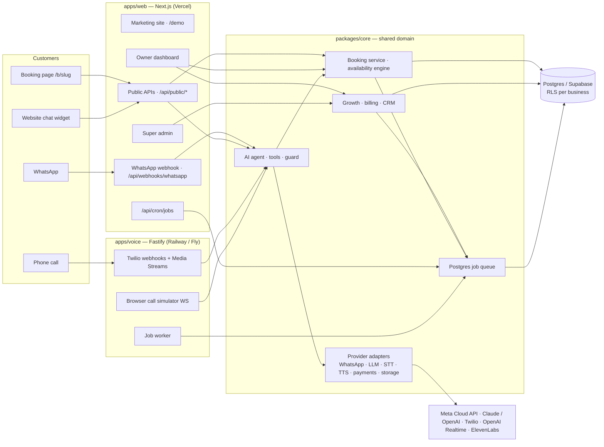

# Fekerte

**The AI receptionist that speaks Lebanese.** Fekerte replaces the front desk of appointment-based businesses in Lebanon — dentists, clinics, physiotherapists, aesthetic clinics, salons, barbers — with:

- an **online booking page** (Arabic / English / French, mobile-first, RTL),
- an **AI WhatsApp receptionist** that answers, books, moves and cancels appointments in Lebanese Arabic, Arabizi, English and French,
- an **AI phone receptionist** (Lebanese Arabic voice) that picks up when nobody can,
- reminders with "reply 1 to confirm", deposits, review requests, recalls, WhatsApp campaigns and an analytics dashboard that proves the ROI,
- billing (Basic / Standard / Premium, manual invoicing in USD), a super-admin panel, a marketing site and a public live demo.

Every external provider sits behind an adapter with a mock, so **the whole product runs locally with zero paid API keys**. Real providers switch on with environment variables.

> Status, what's mocked, and the go-live checklist: **[PROGRESS.md](PROGRESS.md)**.

---

## Contents

1. [Quick start](#quick-start)
2. [What to try](#what-to-try)
3. [Architecture](#architecture)
4. [Repository layout](#repository-layout)
5. [Commands](#commands)
6. [Environment variables](#environment-variables)
7. [Connecting real providers](#connecting-real-providers)
8. [Deploying](#deploying)
9. [Onboarding a real business](#onboarding-a-real-business)
10. [Security model](#security-model)
11. [Testing & evals](#testing--evals)
12. [Troubleshooting](#troubleshooting)

---

## Quick start

Requirements: **Node 22+**, **pnpm 10** (`corepack enable`), and either Docker or a local **Postgres 16**.

```bash
git clone <repo> fekerte && cd fekerte
corepack enable
pnpm install
pnpm dev          # creates .env, starts Postgres via docker compose if needed, migrates, seeds, runs everything
```

That's it. `pnpm dev` runs three processes:

| Process | URL | What |
|---|---|---|
| `web` | http://localhost:3000 | Next.js app: marketing site, booking pages, dashboard, admin, APIs, webhooks |
| `voice` | http://localhost:3001 | Fastify voice server: Twilio webhooks + media streams, browser call simulator, background job worker |
| `cron` | — | pings `/api/cron/jobs` every 20 s (reminders, reviews, recalls, campaigns, billing sweep) |

Without Docker: point `DATABASE_URL` / `TEST_DATABASE_URL` in `.env` at your own Postgres 16 (the user needs `CREATEROLE`; `btree_gist` must be available) and run `pnpm dev`.

### Demo logins

| Role | Email | Password |
|---|---|---|
| Super admin | `admin@fekerte.app` | `admin12345` |
| Owner — Demo Dental Clinic (Premium) | `owner@demo-dental.com` | `demo12345` |
| Owner — Demo Barber Shop (Standard) | `owner@demo-barber.com` | `demo12345` |

Public pages: `/` (marketing), `/demo` (live demo), `/b/demo-dental` and `/b/demo-barber` (booking pages), `/chat/demo-dental` (web chat).

## What to try

- **Book online** on `/b/demo-dental` from a phone-sized window in Arabic. Then open the "change or cancel" link.
- **WhatsApp AI**: Dashboard → Inbox → simulator. Write as a customer: `badde 7jez tanzif bukra`, pick a time, then press "Take over" to reply as staff.
- **Phone AI**: Dashboard → AI receptionist → Call simulator (Chrome: speak, or type). Try `بدي موعد فحص بكرا بعد الضهر`. The AI reads the booking back before confirming.
- **Same calendar, no double bookings**: book the same slot from the booking page, WhatsApp, web chat and the call simulator — only one wins.
- **Growth**: Analytics (ROI hero, busiest hours), Customers → VIP segment → customer timeline, Campaigns → send to a segment, book "Teeth whitening" online to see the deposit hold.
- **Billing & tiers**: log in as the barber (Standard): no phone AI; Billing shows usage and how to pay. As super admin: Invoices → mark paid with a receipt; Plans → change prices; Leads → move a lead through the pipeline.
- **Evals**: `pnpm eval` runs 49 scripted conversations (WhatsApp + voice) and reports the pass rate.

## Architecture



Key ideas:

- **One booking service, one calendar.** Every channel (booking page, dashboard, WhatsApp AI, web chat, phone AI) books through `packages/core/src/booking/service.ts`. A Postgres **exclusion constraint** (staff × time range with buffers) makes double bookings impossible even under races; bookings take an advisory lock per staff member and re-check.
- **The AI never invents facts.** Services, prices and hours come from the database; availability only from the `check_availability` tool; "booked" is only said after `create_booking` returns a saved row. Every tool call is stored on the message and visible in the inbox.
- **Multi-tenant by `business_id`, enforced twice**: in the data-access layer and by **Postgres Row-Level Security** (`withTenant` runs each request as the restricted `fekerte_app` role with the business id set).
- **Adapters + mocks** for WhatsApp, LLM, speech-to-text, text-to-speech, realtime voice, payments and storage.
- **Background work** goes through a Postgres job queue (`FOR UPDATE SKIP LOCKED`, retries, dedupe keys), drained by the voice server's worker and/or the cron endpoint.

## Repository layout

```
apps/
  web/            Next.js App Router (TypeScript, Tailwind 4, shadcn-style UI, i18n ar/en/fr)
    src/app/      routes: / · /demo · /b/[slug] · /chat/[slug] · /dashboard/* · /admin/* · /api/*
    e2e/          Playwright specs (desktop + mobile)
  voice/          Fastify voice server (Twilio, Media Streams, browser simulator, job worker)
packages/
  core/           domain logic shared by both apps
    src/db/           Drizzle schema, tenant helpers (RLS), migrations runner, seed
    src/availability/ DST-correct slot engine (Luxon, Asia/Beirut)
    src/booking/      booking service, tokens, deposit rules
    src/agent/        LLM adapters (Claude, OpenAI-compatible, mock), tools, prompts, guard, runner
    src/channels/     WhatsApp + web chat pipelines
    src/voice/        call session, pipelines (realtime / cascade / <Gather>), TTS, STT, Twilio
    src/growth/       deposits, reviews, recalls, campaigns, analytics
    src/billing/      plans, limits, invoices, trial/overdue sweep
    src/evals/        scripted conversation evals (`pnpm eval`)
    drizzle/          SQL migrations (incl. custom RLS / constraints)
    test/             Vitest (unit + Postgres integration)
scripts/          db-ensure (used by pnpm dev), dev cron pinger, test DB init
```

## Commands

| Command | What |
|---|---|
| `pnpm dev` | Everything (web + voice + cron), with DB auto-setup |
| `pnpm typecheck` · `pnpm lint` | All packages |
| `pnpm test` | Unit + integration tests (uses `TEST_DATABASE_URL`, **reset each run**) |
| `pnpm test:e2e` | Playwright (starts/reuses the dev servers) |
| `pnpm eval` | AI conversation evals; `EVAL_PROVIDER=anthropic` to run against Claude |
| `pnpm db:migrate` · `pnpm db:seed` | Apply migrations · seed demo data (idempotent) |
| `pnpm db:reset` | Drop + migrate + seed the **local** database (refuses non-local URLs) |
| `pnpm db:generate` | Generate a migration after editing `packages/core/src/db/schema.ts` |
| `pnpm clean:next` | Delete the Next.js build/dev cache (see Troubleshooting) |

## Environment variables

[`.env.example`](.env.example) lists **every** variable with comments; `pnpm dev` copies it to `.env`. Summary:

| Variable | Default | Purpose |
|---|---|---|
| **Core** | | |
| `DATABASE_URL` | local Postgres | Main database. Supabase: session pooler or direct URL (with the 6543 transaction pooler set `DATABASE_PREPARE=false`) |
| `DATABASE_POOL_MAX` · `DATABASE_PREPARE` | `10` · on | Connection pool size · prepared statements |
| `TEST_DATABASE_URL` | `…/fekerte_test` | Tests and evals — dropped and recreated each run |
| `APP_URL` · `NEXT_PUBLIC_APP_URL` | `http://localhost:3000` | Public web URL (links in messages, payment links) |
| `APP_SECRET` | dev value | **Required in production** (≥ 32 chars): signs sessions, manage links, chat sessions, voice tokens, payment links |
| `CRON_SECRET` | `dev-cron-secret` | Bearer token for `/api/cron/jobs` |
| `LOG_LEVEL` · `LOG_FORMAT` | `info` · JSON | Structured logs (`pretty` for humans) |
| **Observability & protection** | | |
| `SENTRY_DSN` · `SENTRY_ENVIRONMENT` | — | Send errors to Sentry |
| `HEALTH_MAX_JOB_LAG_SECONDS` | `600` | `/api/health` turns "degraded" when jobs wait longer |
| `RATE_LIMIT_STORE` | `postgres` in prod, `memory` in dev | Shared rate limits across instances |
| `AI_MAX_REPLIES_PER_HOUR` · `AI_MAX_CALLS_PER_HOUR` | `40` · `6` | Per-conversation / per-caller AI caps (then staff takes over) |
| **Auth** | | |
| `AUTH_PROVIDER` | `local` | `local` (email+password, magic links in the log) or `supabase` |
| `NEXT_PUBLIC_SUPABASE_URL` · `NEXT_PUBLIC_SUPABASE_ANON_KEY` | — | Supabase Auth |
| `SEED_ADMIN_EMAIL` · `SEED_ADMIN_PASSWORD` | demo values | Super admin created by `pnpm db:seed` — change before seeding production |
| **WhatsApp** | | |
| `WHATSAPP_PROVIDER` | `mock` | `meta` for the WhatsApp Cloud API |
| `WHATSAPP_ACCESS_TOKEN` · `WHATSAPP_APP_SECRET` · `WHATSAPP_VERIFY_TOKEN` · `WHATSAPP_PHONE_NUMBER_ID` · `WHATSAPP_GRAPH_VERSION` | — · — · — · — · `v24.0` | Meta credentials, webhook signature secret, verify token, default sender, Graph version |
| **AI (LLM)** | | |
| `LLM_PROVIDER` | auto | `anthropic` · `openai` · `mock` (auto = Claude if `ANTHROPIC_API_KEY`, else mock) |
| `ANTHROPIC_API_KEY` · `ANTHROPIC_MODEL` | — · `claude-opus-5-5` | Claude |
| `LLM_EFFORT` · `LLM_VOICE_EFFORT` | `low` · `low` | Reasoning effort for chat / voice turns |
| `OPENAI_API_KEY` · `OPENAI_BASE_URL` · `OPENAI_MODEL` | — · OpenAI · `gpt-4.1-mini` | OpenAI-compatible LLM (also used by STT/TTS/Realtime) |
| **Speech** | | |
| `STT_PROVIDER` · `STT_MODEL` · `STT_API_KEY` · `STT_BASE_URL` | `mock` · `gpt-4o-transcribe` | WhatsApp voice-note transcription |
| `VOICE_PUBLIC_URL` · `NEXT_PUBLIC_VOICE_URL` · `VOICE_PORT` | `http://localhost:3001` · same · `3001` | Voice server URL (https in production) / port |
| `VOICE_PIPELINE` · `VOICE_SILENCE_MS` | `cascade` · `550` | `realtime` or `cascade`; end-of-speech silence |
| `VOICE_JOB_WORKER` · `VOICE_JOB_INTERVAL_MS` | `true` · `15000` | Voice server drains the job queue |
| `TWILIO_ACCOUNT_SID` · `TWILIO_AUTH_TOKEN` · `TWILIO_RECORD_CALLS` | — · — · `true` | Telephony + webhook signature verification + recordings |
| `TWILIO_SAY_VOICE_AR/EN/FR` | Polly voices | Voices for the `<Gather>` fallback |
| `OPENAI_REALTIME_MODEL` · `OPENAI_REALTIME_VOICE` · `OPENAI_REALTIME_URL` · `OPENAI_STT_MODEL` | `gpt-realtime` · `marin` · OpenAI · `gpt-4o-transcribe` | Speech-to-speech and streaming transcription |
| `TTS_PROVIDER` · `ELEVENLABS_API_KEY` · `ELEVENLABS_VOICE_ID` · `ELEVENLABS_MODEL` · `OPENAI_TTS_MODEL` · `OPENAI_TTS_VOICE` | auto · — · — · `eleven_flash_v2_5` · `gpt-4o-mini-tts` · `coral` | Text-to-speech for the cascade pipeline |
| **Billing, growth, storage** | | |
| `PAYMENTS_PROVIDER` · `ALLOW_MOCK_PAYMENTS` | `manual` · `false` | `mock_link` = demo deposit payment page (never charges; off in production) |
| `PAYMENT_INSTRUCTIONS` · `BILLING_COMPANY_DETAILS` | sample text | Shown on invoices |
| `BILLING_GRACE_DAYS` · `BILLING_AUTO_INVOICE` · `USAGE_HARD_CAP_MULTIPLIER` | `7` · `true` · `3` | Overdue grace · monthly auto-invoicing · AI safety cap (× included usage) |
| `REVIEW_REQUEST_DELAY_MINUTES` | `120` | Delay before the rating request |
| `STORAGE_PROVIDER` · `LOCAL_UPLOAD_DIR` · `SUPABASE_URL` · `SUPABASE_SERVICE_ROLE_KEY` · `SUPABASE_STORAGE_BUCKET` | `local` · `.data/uploads` · … · `fekerte-private` | Payment receipts |
| **Marketing / tests** | | |
| `DEMO_BUSINESS_SLUG` · `DEMO_ALLOW_AUDIO` | `demo-dental` · `false` | Public `/demo` business; allow paid audio pipeline on the public demo |
| `EVAL_PROVIDER` · `EVAL_DATABASE_URL` · `EVAL_FILTER` · `EVAL_MIN_PASS_RATE` | `mock` · test DB · — · `0.9` | Evals |
| `E2E_BASE_URL` · `PLAYWRIGHT_CHROMIUM_PATH` | `http://localhost:3000` · — | Playwright |

Platform-provided (don't set): `NODE_ENV`, `PORT`, `VERCEL_GIT_COMMIT_SHA` / `RAILWAY_GIT_COMMIT_SHA` / `FLY_IMAGE_REF`.

## Connecting real providers

Each provider is independent — turn on only what you need. Verify vendor details against their current docs; the adapters were written from documented API shapes and are covered by unit tests with stubs, but **none was exercised against the live service from this build environment** (see PROGRESS.md).

### Claude (the AI receptionist's brain)

1. Create an API key at console.anthropic.com.
2. `ANTHROPIC_API_KEY=…` (model defaults to `claude-opus-5-5`; `LLM_EFFORT=low` keeps replies fast).
3. Run the evals against it: `EVAL_PROVIDER=anthropic pnpm eval` — aim for ≥ 90 % before going live.

The system prompt is split into a cached stable part (persona, services, hours, policies, rules) and a small dynamic part (time, customer, memory), so most input tokens are cache hits.

### WhatsApp (Meta WhatsApp Cloud API)

1. Meta Business account → developers.facebook.com → create an app → add **WhatsApp**. Add and verify the business phone number (it must not be registered in the WhatsApp app).
2. Create a **System User** with `whatsapp_business_messaging` and generate a permanent token → `WHATSAPP_ACCESS_TOKEN`.
3. Webhook: callback URL `https://<your-domain>/api/webhooks/whatsapp`, verify token = `WHATSAPP_VERIFY_TOKEN`, subscribe to `messages`. Set `WHATSAPP_APP_SECRET` (App settings → Basic) — every POST is checked against `X-Hub-Signature-256`.
4. Copy the **phone number ID** into the business's AI settings (Dashboard → AI receptionist → WhatsApp), or `WHATSAPP_PHONE_NUMBER_ID` for a single-tenant setup.
5. Submit the message templates from `packages/core/src/notifications/templates.ts` (confirmation, reminders, deposit request, review request, recall, campaign) in Arabic, English and French with the same variable order; marketing ones as **MARKETING**.
6. `WHATSAPP_PROVIDER=meta`.

Free-form replies are only allowed within 24 h of the customer's last message — the AI only replies to inbound messages; everything we start (reminders, reviews, recalls, campaigns) uses templates.

### Phone (Twilio + Lebanese numbers)

1. Twilio account → buy a voice-capable number (Twilio may not sell +961 numbers; any country works because the clinic **forwards** to it).
2. Number → Voice → "A call comes in": Webhook `POST https://<voice-domain>/twilio/voice`; status callback `https://<voice-domain>/twilio/status`.
3. `TWILIO_ACCOUNT_SID`, `TWILIO_AUTH_TOKEN` (webhooks are rejected unless the `X-Twilio-Signature` matches), `VOICE_PUBLIC_URL=https://<voice-domain>`.
4. Put the Twilio number in the business's AI settings ("Fekerte phone number") and the clinic's real number as the transfer number.
5. At the clinic's carrier (Alfa / touch / Ogero), set **call forwarding** to the Twilio number: always, or on no-answer/busy (pairs with the "only when staff don't pick up" mode). Alternative for heavy use: a SIP trunk from a Lebanese carrier into Twilio Elastic SIP.

With only Twilio credentials, calls use Twilio's built-in speech recognition (`ar-LB`) and `<Say>`. For natural Lebanese voice add:

- **Cascade** (recommended): `OPENAI_API_KEY` (streaming transcription) + `ELEVENLABS_API_KEY` + `ELEVENLABS_VOICE_ID` (choose a Levantine/Lebanese Arabic voice). `VOICE_PIPELINE=cascade`.
- **Realtime speech-to-speech**: `OPENAI_API_KEY`, `VOICE_PIPELINE=realtime` (lowest latency; Lebanese accent quality depends on the model).

Test from the browser first (Dashboard → Call simulator, "audio" mode), then call the number.

### Voice notes on WhatsApp

`STT_PROVIDER=openai` (+ `OPENAI_API_KEY`). Without it the AI politely asks the customer to type.

### Supabase (database, auth, storage)

- **Database**: use the connection string (session pooler, port 5432) as `DATABASE_URL`; run `pnpm db:migrate` against it. The migration creates the `fekerte_app` role and RLS policies; all tables have RLS on, so the anon/authenticated API keys can't read anything.
- **Auth** (optional): `AUTH_PROVIDER=supabase`, `NEXT_PUBLIC_SUPABASE_URL`, `NEXT_PUBLIC_SUPABASE_ANON_KEY`; add `https://<domain>/auth/callback` to the redirect URLs. Supabase sends the magic-link emails.
- **Storage** (receipts): create a **private** bucket, set `STORAGE_PROVIDER=supabase`, `SUPABASE_URL`, `SUPABASE_SERVICE_ROLE_KEY` (server-only).

### Sentry

`SENTRY_DSN=…` — errors from both apps (structured `logger.error` calls and Next.js request errors) are sent with customer content stripped. To use the official SDK instead, install it and pass its `captureException` to `setErrorHook` (`packages/core/src/lib/logger.ts`).

## Deploying

Target setup: **Supabase** (Postgres) + **Vercel** (web) + **Railway or Fly.io** (voice server — it needs long-lived WebSockets, which serverless can't hold).

### 1. Database (Supabase)

1. Create a project (region: Frankfurt `eu-central-1` is closest to Lebanon).
2. Copy the **session pooler** connection string.
3. From your machine: `DATABASE_URL=<supabase-url> pnpm db:migrate`.
4. Seed plans and your super admin: set `SEED_ADMIN_EMAIL` / `SEED_ADMIN_PASSWORD` to real values, then `DATABASE_URL=<supabase-url> pnpm db:seed` (this also creates the two demo businesses used by `/demo`; disable or delete them in the admin panel if you don't want a public demo).

### 2. Web (Vercel)

1. Import the repository; **Root Directory** `apps/web` (Vercel detects pnpm workspaces and Next.js).
2. Environment variables: at least `DATABASE_URL`, `APP_SECRET` (`openssl rand -hex 32`), `CRON_SECRET`, `APP_URL` + `NEXT_PUBLIC_APP_URL` (your domain), `VOICE_PUBLIC_URL` + `NEXT_PUBLIC_VOICE_URL` (voice server URL), plus the providers you enable. Production defaults: `RATE_LIMIT_STORE=postgres`, mock WhatsApp webhook disabled, unsigned Twilio requests rejected.
3. `apps/web/vercel.json` schedules `/api/cron/jobs` every minute (Vercel sends `Authorization: Bearer $CRON_SECRET`). Per-minute crons need a paid Vercel plan — on Hobby, the voice server's worker drains the queue anyway (`VOICE_JOB_WORKER=true`), so the cron is just a backup.
4. Check `https://<domain>/api/health`.

### 3. Voice server (Railway or Fly.io)

Both build `apps/voice/Dockerfile` from the repository root and health-check `/health`.

- **Railway**: new service from the repo → it picks up `railway.json` (Dockerfile build, health check) → set variables (same `DATABASE_URL`, `APP_SECRET`, `APP_URL`, `VOICE_PUBLIC_URL=https://<railway-domain>`, Twilio/OpenAI/ElevenLabs/LLM keys) → generate a public domain.
- **Fly.io**: `fly launch --no-deploy --copy-config --config apps/voice/fly.toml`, `fly secrets set DATABASE_URL=… APP_SECRET=… …`, then `fly deploy --config apps/voice/fly.toml --dockerfile apps/voice/Dockerfile`. One machine stays running (calls must not cold-start).

`APP_SECRET` **must be identical** on web and voice (browser call tokens and stream signatures are cross-checked).

### 4. Point the providers at production

Meta webhook → `https://<web-domain>/api/webhooks/whatsapp`; Twilio number → `https://<voice-domain>/twilio/voice`. Run a test booking through each channel.

## Onboarding a real business

1. **Sign-up**: the owner signs up at `/signup` (or you create the account and send a magic link) and completes onboarding: business type (presets for services and hours), name, city, language.
2. **Catalog**: Dashboard → Services (durations, buffers, prices in USD, "from" prices, deposits, recall intervals), Staff (who does what, own hours), Hours & holidays.
3. **Booking page**: Settings → booking rules (notice, how far ahead, cancellation window, approval, reminders, "reply 1 to confirm", deposits), policies, Google review link, branding. The privacy/consent line is shown on every booking automatically. Share `/b/<slug>` on Instagram/Google; embed the chat widget snippet from AI settings on their website.
4. **AI receptionist**: AI settings → persona name, tone, extra information (parking, payment methods — never prices; those come from Services). Test in the WhatsApp simulator and call simulator.
5. **WhatsApp**: connect their WhatsApp Business number (phone number ID in AI settings) once Meta verification is done.
6. **Phone**: assign a Twilio number, choose when the AI answers (always / after hours / when staff don't pick up), set the transfer number, set up carrier forwarding.
7. **Plan & billing**: Admin → business → plan, fees (negotiated prices allowed), trial end. Issue the first invoice; mark it paid when the transfer arrives (reference + receipt).
8. **Go live**: watch the inbox and calls for the first days; Analytics shows bookings the AI made from week one.

## Security model

- **Tenant isolation**: every tenant table has a `business_id` and RLS; requests run as `fekerte_app` with `app.business_id` set (`packages/core/src/db/tenant.ts`). Tests assert that every public table has RLS on and that cross-tenant reads/writes/moves fail. Billing tables are read-only for tenants; plan/status/trial/feature flags can only be changed by super admins (DB trigger).
- **AI safety**: the AI can only act through typed, schema-validated tools scoped to the verified customer (WhatsApp sender / caller ID; on web chat only appointments booked in that chat). Prices, availability and policies are enforced server-side. A model-independent guard flags injection attempts and **redacts any phone number or e-mail** that isn't the business's or the verified customer's (`packages/core/src/agent/guard.ts`); tests use a deliberately malicious model to prove it.
- **Webhooks**: Meta `X-Hub-Signature-256` and Twilio `X-Twilio-Signature` verified; Twilio media streams carry a signed parameter; the mock WhatsApp webhook is disabled in production.
- **Tokens**: manage links, web-chat sessions, browser-call tokens and payment links are HMAC-signed with `APP_SECRET`; sessions are httpOnly, `SameSite=Lax`, `Secure` in production.
- **Abuse & cost**: rate limits on login (per IP and per account), public APIs, demo requests and demo calls (shared Postgres store in production); per-conversation AI reply caps and per-caller AI call caps; monthly AI usage hard cap per plan.
- **Headers**: `X-Frame-Options: DENY` + `frame-ancestors 'none'` everywhere except the embeddable `/chat/*`, `nosniff`, strict referrer policy, HSTS in production.
- **Data minimisation**: name, phone, language, appointments, notes — no medical history. Consent text on booking; marketing only with explicit opt-in; `STOP` opts out instantly.

## Testing & evals

- `pnpm test` — 180 unit and Postgres integration tests: availability/DST, concurrent double-booking races, RLS isolation, jobs, WhatsApp pipeline, voice (µ-law, TwiML, signatures), billing, growth, leads, rate limits, prompt-injection defenses.
- `pnpm test:e2e` — 22 Playwright flows on desktop and mobile: Arabic mobile booking + manage/cancel, onboarding, dashboard calendar, admin impersonation, WhatsApp simulator + staff takeover, web chat, browser call (Lebanese Arabic), billing, growth (analytics, segments, campaigns, deposits), marketing site, demo request → leads pipeline, live demo.
- `pnpm eval` — 49 scripted conversations in Arabic, Arabizi, English and French (booking, info, guardrails incl. prompt injection, reschedule, cancel, mixed language, 10 voice scenarios). Mock provider by default; `EVAL_PROVIDER=anthropic pnpm eval` for Claude. Writes `.eval-report.json` with full transcripts.

## Troubleshooting

- **Pages reload endlessly in dev** (Turbopack logs "HMR hash mismatch"): the dev cache was left inconsistent by an abrupt kill of `next dev`. Stop `pnpm dev`, run `pnpm clean:next`, start again.
- **`pnpm dev` can't reach Postgres**: start Docker (it runs `docker compose up -d db` for you) or set `DATABASE_URL` to your own Postgres 16.
- **Port in use**: another `next dev` or voice server is still running (`lsof -i :3000` / `:3001`).
- **Call simulator says the voice server is unreachable**: check `http://localhost:3001/health`; `NEXT_PUBLIC_VOICE_URL` must point to it.
- **Too many login attempts in tests**: login is limited to 10/min per account; the Playwright helper reuses sessions.
